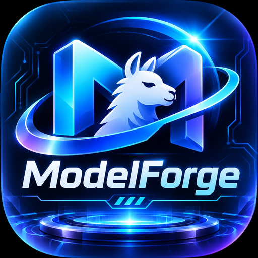
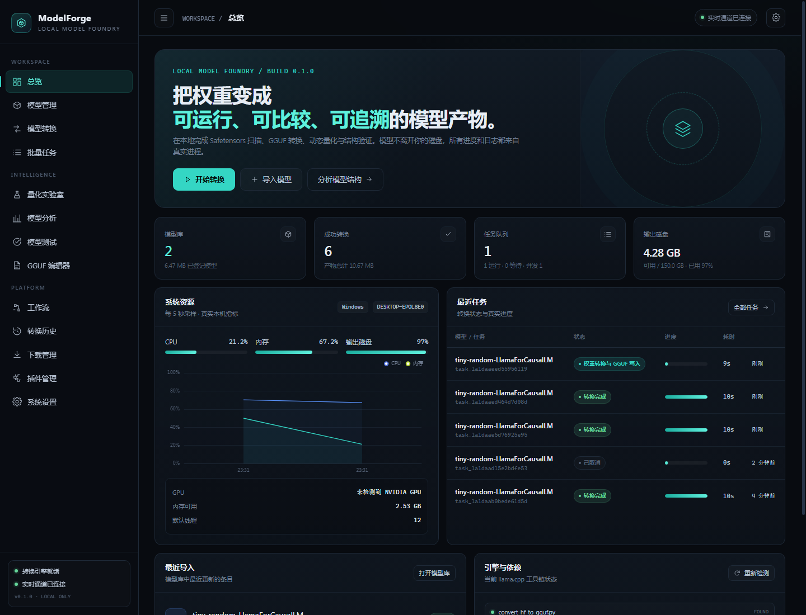

# ModelForge

<p align="center">
  
</p>

<p align="center">
  <strong>Local AI model management, conversion &amp; quantization workstation.</strong>
</p>

<p align="center">
  <a href="#download">Download</a> ·
  <a href="#features">Features</a> ·
  <a href="#build-from-source">Build</a> ·
  <a href="#cli">CLI</a> ·
  <a href="README.zh-CN.md">简体中文</a>
</p>

ModelForge is a local workstation for AI models. A C++17 backend does the real
work — scanning Safetensors directories, invoking llama.cpp, quantizing,
validating, checksumming — and a Vue 3 Web UI drives it from the browser. The
point is not to wrap one conversion script: model scanning, real child
processes, a task queue, live events, evidence-based logs and artifact
validation are organized into a single runnable application.

Current release: **1.0.0**. Windows is built and validated on real hardware;
Linux, macOS, Android (Termux) and openEuler are cross-built and statically
checked. See [docs/cross-platform.md](docs/cross-platform.md).



## Why ModelForge

Converting a model locally usually means juggling a Python script, a quantizer
binary, a notes file and a shell history. ModelForge turns that into a tracked
pipeline: every model is indexed, every conversion is a task with a log, every
output is validated and checksummed, and every artifact can be traced back to
the task that produced it.

It is aimed at people who run models on their own machine and want to know what
actually happened — not at hosted inference services.

## Features

### Implemented

- **Model library** — scan a directory, parse `config.json`, Safetensors
  headers, shard indexes and tokenizer files.
- **Integrity checks** — config, weights, shards, tokenizer and leftover temp
  files.
- **Architecture analysis** — layer count, hidden size, attention/KV heads,
  vocabulary, context length and parameter scale.
- **Real GGUF conversion** — invokes llama.cpp `convert_hf_to_gguf.py`; nothing
  is simulated.
- **Real quantization** — invokes `llama-quantize`, with quant types parsed from
  its `--help` output at runtime.
- **Two-stage pipeline** — the intermediate GGUF and the quantized output are
  separate artifacts; the intermediate file can be kept.
- **Task queue** — priority, pause queued tasks, cancel child processes, retry
  failures, concurrency limit.
- **Live events** — WebSocket as the primary channel, SSE and HTTP polling as
  fallbacks.
- **Structured logs** — real stdout/stderr, level filter, search, pause-follow,
  copy and download.
- **Honest progress** — `measured`, `estimated` and `indeterminate` instead of
  invented percentages.
- **GGUF validation** — magic, version, metadata, tensor count and file
  existence.
- **SHA256** — streamed, never loading a model into memory at once.
- **Hugging Face download center** — official API resolution, file filtering,
  concurrent downloads, HTTP Range resume, pause/resume/cancel/retry, SHA256
  verification, restart recovery and automatic library import.
- **llama.cpp runtime** — detects the bundled official release, checks upstream
  updates, downloads CUDA/Vulkan/CPU assets per platform, verifies SHA256 and
  extracts the archive untouched.
- **Model library, conversion history, quantization lab, size estimation,
  workflows, settings import/export.**
- **Web UI** — dark / light / follow-system themes, Simplified Chinese and
  English, fifteen functional sections, responsive layout.
- **Presets** — built-in read-only presets plus custom presets, applied to the
  conversion form in one click.
- **PPL evaluation** — runs official `llama-perplexity` on fixed text and
  compares results per model (PPL, relative degradation, token count, duration,
  peak memory), with cancel and custom corpora.
- **Task resource sampling** — per-stage child-process CPU time, peak memory and
  disk IO (Windows uses Job Object accounting, which also covers the venv
  launcher).
- **Folder watching** — polls watched directories, imports new model folders
  after signature de-duplication, optionally queues conversions from a preset,
  and records an event log.
- **Model version tree** — source model to each GGUF artifact, with quant type,
  size, SHA, producing tool, task and missing-artifact markers.
- **OpenAPI 3.0.3** — generated from the routes that are actually registered,
  with an `x-route-coverage` self-check.

### Experimental

- **Plugin conversion engines** — `plugins/*.json` manifests are read and listed;
  unknown binaries are never loaded.

### Planned

- Remote conversion nodes.
- A signed plugin ecosystem around the engine interface.

## Architecture

```
┌──────────────────────────────┐        ┌──────────────────────────────────┐
│  Vue 3 + TypeScript Web UI   │  HTTP  │  C++17 backend (single binary)   │
│  Vite build, ECharts         │◄──────►│  cpp-httplib + WebSocket         │
│  semantic CSS variables      │  WS/SSE│  SQLite, Job Object / POSIX      │
└──────────────────────────────┘        └───────────────┬──────────────────┘
                                                        │ spawns
                                    ┌───────────────────┴──────────────────┐
                                    │ llama.cpp official releases          │
                                    │ convert_hf_to_gguf.py, llama-quantize│
                                    │ llama-perplexity                     │
                                    └──────────────────────────────────────┘
```

- **Backend**: C++17, cpp-httplib 0.20.0, nlohmann/json 3.11.3,
  ghc::filesystem, SQLite 3.53.4, WinHTTP on Windows and a `curl` child
  process on POSIX.
- **Frontend**: Vue 3, TypeScript, Vite/Rolldown, ECharts, semantic CSS
  variables for both themes.
- **Storage**: a single SQLite database under the runtime directory; models,
  outputs and logs live beside it.

## Conversion pipeline

```
Safetensors model
   → scan & analyze
   → convert_hf_to_gguf.py   (intermediate GGUF)
   → llama-quantize          (quantized GGUF)
   → GGUF validation + SHA256
   → model library / version tree
   → optional PPL evaluation
```

## Download

Portable builds are attached to
[GitHub Releases](https://github.com/Lynx3211463259/ModelForge/releases).

| Platform | Artifact | Status |
| --- | --- | --- |
| Windows x64 | `ModelForge-1.0.0-win64.zip` | Built and validated on Windows 11 |
| Linux x64 / arm64 | `ModelForge-1.0.0-linux-{x64,arm64}.tar.gz` | Cross-built, not run on device |
| macOS arm64 / x64 | `ModelForge-1.0.0-macos-{arm64,x64}.tar.gz` | Cross-built, unsigned |
| Android (Termux) | `ModelForge-1.0.0-android-{arm64,x64}.tar.gz` | Cross-built, not run on device |
| openEuler x64 / arm64 | `ModelForge-1.0.0-openeuler-{x64,arm64}.tar.gz` | Cross-built, not run on device |
| iOS | — | Blocked by platform policy (no long-lived background service, signing required) |

### Windows

1. Download and extract `ModelForge-1.0.0-win64.zip`.
2. Run `start.bat`, or `modelforge.exe serve` from the extracted folder.
3. The server picks a free port and opens the browser automatically. The console
   prints the URL; pass `--no-browser` to suppress it.

The portable package already contains an official llama.cpp release under
`tools\llama.cpp\`. Real conversion still needs Python 3.10+ with the
llama.cpp conversion dependencies; the runtime page can install and verify the
llama.cpp assets.

### Linux / macOS / Android / openEuler

```bash
tar xzf ModelForge-1.0.0-linux-x64.tar.gz
cd linux-x64
./modelforge serve --no-browser
```

Android is a Termux console application, not an APK. Inside Termux:

```bash
bash run.sh          # installs curl/python, then starts the server
```

See [docs/cross-platform.md](docs/cross-platform.md) for service definitions and
per-platform notes.

## System requirements

Validated configuration:

- Windows 11 x64, MinGW-w64 GCC 16.2.0 build.
- Python 3.10+ for real conversions.
- Enough free disk space for the source model, the intermediate GGUF and the
  quantized output.

Estimated, not formally benchmarked:

- 8 GB RAM for small models; larger models scale with the model itself.
- Any x64 CPU; GPU acceleration depends on the llama.cpp asset you install.

## Usage

1. **Import** — point the Models page at a model directory; the scanner picks up
   config, weights, shards and tokenizer.
2. **Analyze** — inspect architecture, parameter scale and integrity warnings.
3. **Convert** — choose an output type (for example `f16`), target directory and
   name; the task runs the real conversion script.
4. **Quantize** — run `llama-quantize` on the intermediate GGUF, or submit a
   batch in the quantization lab.
5. **Validate** — GGUF structure and SHA256 are checked and recorded.
6. **Track** — the version tree and history tie every artifact to its task and
   log.

## CLI

```bash
modelforge scan --input ./models
modelforge validate --input ./output/model.gguf
modelforge convert --input ./models/MyModel --output ./output \
  --name MyModel.Q4_K_M --outtype f16 --quant Q4_K_M --threads 4
modelforge serve --no-browser
modelforge download hf --repo org/model --include "*.safetensors"
modelforge download list
modelforge llama status
modelforge llama check
```

The CLI and the Web UI share the same task manager, download manager and
cross-process locks, so a conversion started in the browser is visible from the
terminal and vice versa.

## Build from source

Requirements: CMake 3.16+, GCC 9+ or MSVC 2019+, Node.js 20+, Python 3.10+ for
conversions, and zig 0.13/0.14 for POSIX cross-builds.

Windows:

```powershell
scripts\build-windows.ps1 -ToolchainRoot C:\path\to\mingw64
```

Backend only:

```powershell
cmake -S . -B build-win -G "MinGW Makefiles" `
  -DCMAKE_C_COMPILER=C:/path/mingw64/bin/gcc.exe `
  -DCMAKE_CXX_COMPILER=C:/path/mingw64/bin/g++.exe
cmake --build build-win -j 4
ctest --test-dir build-win --output-on-failure
```

Frontend only:

```bash
cd frontend && npm install && npm run build
```

POSIX cross-builds:

```bash
ZIG=/path/to/zig bash scripts/build-linux.sh
ZIG=/path/to/zig bash scripts/build-macos.sh
ZIG=/path/to/zig bash scripts/build-android.sh
ZIG=/path/to/zig bash scripts/build-openeuler.sh
```

More detail: [docs/development.md](docs/development.md),
[docs/cross-platform.md](docs/cross-platform.md).

## Roadmap

- **1.0.x** — stability fixes, POSIX on-device validation, packaging polish.
- **1.1** — deeper model analysis and comparison.
- **1.2** — workflow automation improvements.
- **2.0** — remote conversion nodes and a plugin ecosystem.

Items are not marked done until the code and tests support the claim.

## Contributing

Issues and pull requests are welcome. Read
[CONTRIBUTING.md](CONTRIBUTING.md) for setup, build, test and review
expectations. Use the issue templates for bug reports and feature requests.

## FAQ

**Conversion failed. Where do I look?**
Open the task in the Tasks page and read its structured log; it contains the
real child-process stdout/stderr. The same text is under `data/logs/`.

**How do I verify a GGUF?**
Run `modelforge validate --input <file.gguf>`, or use the validation panel in
the UI. It checks the magic, version, metadata, tensor count and file presence,
and computes SHA256.

**Can I convert a Hugging Face model directly?**
Yes. Use the download center to fetch the repository, then convert the local
directory. Files are filtered, resumed and checksummed.

**How do I configure the toolchain?**
In Settings, point ModelForge at your Python interpreter and llama.cpp
binaries, or install an official llama.cpp release from the runtime page.

**Model paths look wrong.**
ModelForge stores paths as given to it. Use absolute paths when the working
directory may change between runs.

**Disk space ran out mid-conversion.**
Free space for the intermediate GGUF (often comparable to the source) plus the
quantized output, then retry the task; completed stages are kept.

**Permission errors on POSIX.**
Ensure the data directory is writable by the user running the server. Do not
run it with elevated privileges.

## License

MIT. See [LICENSE](LICENSE). Third-party components keep their own licenses.

## Acknowledgements

- [llama.cpp](https://github.com/ggml-org/llama.cpp) — conversion, quantization
  and perplexity tooling, distributed as official release archives.
- [SQLite](https://sqlite.org/) — local storage.
- [cpp-httplib](https://github.com/yhirose/cpp-httplib) — HTTP server.
- [nlohmann/json](https://github.com/nlohmann/json) — JSON.
- [ghc::filesystem](https://github.com/gulrak/filesystem) — filesystem shim.
- [Vue 3](https://vuejs.org/), [Vite](https://vitejs.dev/),
  [ECharts](https://echarts.apache.org/) — Web UI.
