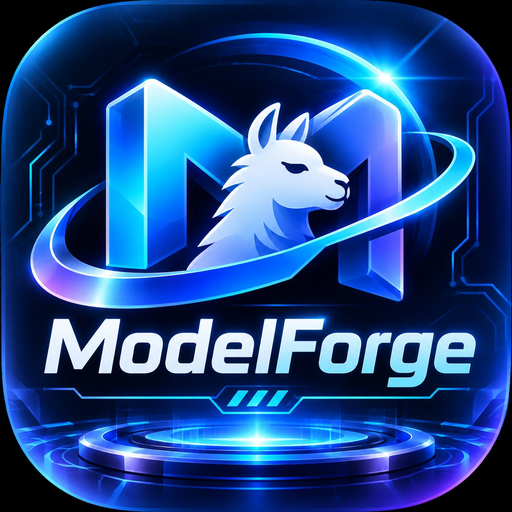
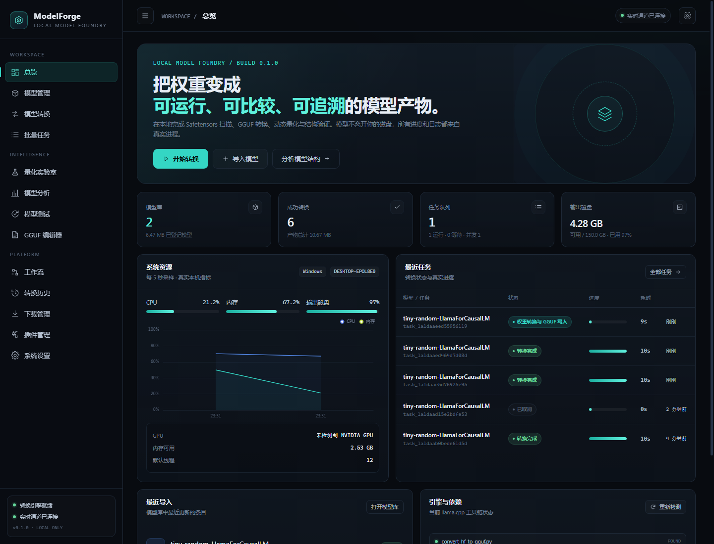

# ModelForge

<p align="center">
  
</p>

ModelForge 是一个以 **C++ 为核心后端、Web UI 为交互界面** 的本地 AI 模型转换与管理平台。重点不是演示一个转换脚本，而是把模型扫描、真实子进程、任务队列、实时事件、证据化日志和产物验证组织成一套可运行软件。

> 当前版本：`1.0.0`（跨平台：Windows/Linux/macOS/Android(Termux)/openEuler 独立构建产物；iOS 受 Apple 签名与平台策略阻塞，详见 `docs/cross-platform.md`）。（新增 Hugging Face 下载中心；llama.cpp 改为官方 release 原样分发，并新增运行引擎的版本识别与更新下载）。已验证 Windows 11 + MinGW-w64 GCC 16.2.0 + llama.cpp 官方发行版转换链。Linux/macOS 的进程与文件代码已提供，但本版本未在对应环境实测。



## 1. 核心能力

- 本地模型目录导入：解析 `config.json`、Safetensors 头部、分片索引与 Tokenizer 文件。
- 完整性检查：配置、权重、分片、Tokenizer、临时文件。
- 模型结构分析：层数、Hidden Size、Attention/KV Heads、词表、上下文、参数规模。
- 真实 GGUF 转换：调用 llama.cpp `convert_hf_to_gguf.py`，不模拟转换。
- 真实量化：调用 `llama-quantize`，量化类型从 `--help` 动态解析。
- 两阶段流水线：中间 GGUF 与量化产物分离，可保留中间文件。
- 任务队列：优先级、暂停排队任务、取消子进程、失败重试、并发上限。
- 实时事件：WebSocket 主通道，SSE 与 HTTP 轮询备用。
- 结构化日志：真实进程 stdout/stderr、级别过滤、搜索、暂停跟随、复制与下载。
- 进度语义：`measured` / `estimated` / `indeterminate`，不伪造百分比。
- GGUF 结构验证：魔数、版本、元数据、张量数量与文件存在性。
- SHA256：流式计算，不把模型一次性载入内存。
- Hugging Face 下载中心：官方 API 解析、文件筛选、多文件并发、HTTP Range 断点续传、暂停/继续/取消/重试、SHA256 校验、重启恢复、自动导入模型库；同时支持 **datasets 数据集**（自动识别 `huggingface.co/datasets/...`，按 parquet/arrow/csv/jsonl 等分类，落盘后登记离线资源库）。
- llama.cpp 官方发行版运行时：原样分发官方 release 资产识别本地版本、检查官方更新、按平台/后端下载 CUDA/Vulkan/CPU 资产、sha256 校验后原样解压并写回工具路径；**多后端并存**，各自独立目录，可随时启用/删除（启用只改写工具路径）。
- 离线资源库：统一索引本地模型、数据集与推理后端，检测路径与体积，可导出带 manifest + SHA256SUMS 的离线包（可选复制文件），并在无网络机器上导入。
- 依赖健康自检：数据库完整性、目录权限、磁盘空间、Python 与转换依赖、llama.cpp 全部工具、后端清单、离线资源完整性、监听配置；可选网络探测；提供安全的一键修复。
- 启动自动更新检查：可开关（默认开启），同时检查 ModelForge 与 llama.cpp；仅在有更新时于页面顶部显示横幅与“更新”按钮，离线/失败/已是最新时静默且不阻断启动。
- 模型库、转换历史、量化实验室、体积估算、工作流、CLI、设置导入导出。
- Web UI：深色 / 浅色 / 跟随系统三态主题，简体中文与英文双语，17 个功能入口，响应式布局。
- iOS 分发路线评估见 `docs/ios-distribution.md`；当前无 iOS 可分发产物。
- 配置预设页：内置只读预设 + 自定义预设的增删改，一键套用到转换页。
- PPL 质量评测：调用官方 `llama-perplexity` 在固定文本上评测每个 GGUF，结果按模型对比（PPL、相对劣化、Token 数、耗时、峰值内存），支持取消与自定义语料。
- 任务级资源采样：按阶段记录子进程 CPU 时间、峰值内存、磁盘读写（Windows 使用 Job 对象账户信息，覆盖 venv python 的子进程）。
- 文件夹监控：轮询监控目录，新模型目录按签名去重后自动导入，可选按预设自动排队转换，并提供事件日志。
- 模型版本树：源模型 → 每个 GGUF 产物，含量化类型、大小、SHA、生成工具、任务与缺失标记。
- OpenAPI 3.0.3：由实际注册的路由自动生成（路径/参数/请求体/响应/schema），带 `x-route-coverage` 自检。

## 2. 已验证事实

本次交付环境中完成了以下验证：

| 验证项 | 状态 | 证据 |
|---|---|---|
| C++ 后端编译 | 通过 | `build-win/bin/modelforge.exe`，静态链接 libstdc++/winpthread |
| 单元测试 | 通过 | SHA-256、SHA-1、WebSocket Accept、文件名清洗、文本工具 |
| SQLite 初始化与迁移 | 通过 | 可执行文件旁 `data/modelforge.db`（旧目录自动迁移） |
| HTTP API | 通过 | `/api/v1/health`、`/settings`、`/models`、`/conversions` 等 |
| WebSocket 握手 | 通过 | RFC 6455 `Sec-WebSocket-Accept` 校验 |
| 模型扫描 | 通过 | 21 张量、7,248 参数、LlamaForCausalLM |
| 真实转换（合成微型模型） | 通过 | F16 → Q4_K_M，21 张量 |
| 真实转换（公开 HF 模型） | 通过 | `hf-internal-testing/tiny-random-LlamaForCausalLM` → Q4_K_M |
| 真实量化 | 通过 | Q4_K_M，GGUF v3，21 张量，2,789,056 字节 |
| GGUF 结构验证 | 通过 | `valid=true`、33 个元数据字段 |
| SHA256 | 通过 | `0b06552167f79bc0a358df01020853d786ae6e5039a009d078b653fe55ab33d0` |
| llama-cli 深度验证 | 通过 | 加载产物并生成 Token，exit 0 |
| llama-bench | 通过 | 真实 CPU 基准，prompt/gen 两组样本 |
| 任务取消 | 通过 | 运行中任务终止并进入 CANCELED |
| 转换产物下载 / 报告 / 日志 | 通过 | 文件哈希与任务结果一致 |
| HF 下载集成测试 | 通过 | 14/14，真实仓库与服务，见 `docs/test-report-downloader.md` |
| HF 断点续传 / 重启恢复 | 通过 | Range 续传、`.mfpart` 保留、重启转 paused 后继续完成 |
| CLI 与 Web 并存 | 通过 | 跨进程锁与状态同步，无重复执行 |
| WebSocket 断线重连 | 通过 | 断网 → 离线 → 自动恢复“已连接” |
| 前端 13 路由运行时检查 | 通过 | 无 Vue 运行时异常，页面均渲染 |

用于验证的模型：

- `models/TinyLlamaForge-64/`：本地生成的合法微型 Llama，用于快速链路测试。
- `models/TinyRandomLlama/`：来自 Hugging Face `hf-internal-testing/tiny-random-LlamaForCausalLM` 的公开测试模型，用于真实 Tokenizer、转换、量化、llama-cli 加载与推理验证。

这些模型只用于功能验证，不代表生产模型质量或性能。

## 3. 架构

```text
Browser (Vue 3 + TypeScript + Pinia + ECharts)
   │ REST / SSE
   ▼
C++20 application service
   ├── API + validation + static UI
   ├── SQLite repository
   ├── EventHub ──► WebSocket / SSE
   ├── TaskManager (queue, priority, cancellation, reconciliation)
   ├── Engine adapters (capability detection, no shell construction)
   └── ProcessRunner (CreateProcessW + Job Object / POSIX fork + process group)
          │
          ├── .venv/bin/python convert_hf_to_gguf.py
          ├── llama-quantize
          └── llama-cli / llama-bench (tester / benchmark)
   ▼
Artifacts: GGUF + JSONL logs + report manifest + SHA256
```

详细设计见 [`docs/architecture.md`](docs/architecture.md)，需求模块覆盖状态见 [`docs/feature-matrix.md`](docs/feature-matrix.md)。

## 4. 目录结构

```text
ModelForge/
├── CMakeLists.txt
├── backend/
│   ├── include/modelforge/        # 领域接口
│   ├── src/                       # C++ 实现
│   └── third_party/               # cpp-httplib / nlohmann json / SQLite / ghc::filesystem
├── frontend/
│   ├── src/components/            # 通用组件
│   ├── src/views/                 # 13 个页面
│   ├── src/stores/                # Pinia
│   └── dist/                      # 已构建的 Web UI
├── docs/                          # 架构、API、开发、SQL schema、示例配置
├── scripts/                       # Windows 构建、启动、打包、测试脚本
├── tests/
│   ├── unit/                      # C++ 单元测试
│   └── integration/               # API 冒烟测试
├── build-win/bin/modelforge.exe   # 编译产物；运行时目录默认创建在它旁边
├── data/                          # 旧版运行目录（首次升级会复制到可执行文件旁）
├── output/                        # 旧版默认转换输出
├── models/                        # 旧版默认模型目录（含微型验证模型）
└── temp/
```

## 5. 快速启动

### 5.1 前置条件

- Windows 10/11（当前实测平台）
- CMake ≥ 3.16
- 支持 C++17 且带线程支持的编译器。**不要使用缺少 `std::mutex` 的旧 MinGW 单线程构建。**
- Node.js ≥ 20（仅构建前端需要）
- Python 3.10–3.14（转换工具的运行时依赖）
- llama.cpp 官方发行版（随包分发，或由 **运行引擎** 页面下载）

本机验证环境：

- CMake 4.4.4
- WinLibs MinGW-w64 GCC 16.2.0（UCRT、POSIX 线程）
- Node.js 22.22.2
- Python 3.13.14

### 5.2 构建 C++ 后端

```powershell
cmake -S . -B build-win -G "MinGW Makefiles" `
  -DCMAKE_BUILD_TYPE=Release `
  -DCMAKE_C_COMPILER=C:/path/to/mingw64/bin/gcc.exe `
  -DCMAKE_CXX_COMPILER=C:/path/to/mingw64/bin/g++.exe `
  -DCMAKE_MAKE_PROGRAM=C:/path/to/mingw64/bin/mingw32-make.exe

cmake --build build-win -j 4
```

如果 `g++` 已正确位于 `PATH`，可直接：

```powershell
scripts/build-windows.ps1
```

后端产物：`build-win/bin/modelforge.exe`。

### 5.3 构建 Web UI

```powershell
cd frontend
npm install
npm run build
```

`frontend/dist/` 由 C++ 服务直接托管，无需单独运行前端服务器。

### 5.4 准备转换环境

```powershell
python -m venv .venv
.venv\Scripts\python.exe -m pip install -r ..\llama.cpp\requirements\requirements-convert_hf_to_gguf.txt
```

或在项目目录执行：

```powershell
scripts/setup-python.ps1
```

### 5.5 llama.cpp 运行时（官方原样分发）

ModelForge 不再构建或裁剪 llama.cpp：随包携带的是 **官方 GitHub release 资产原样解压结果**，保留官方文件、目录结构、版本号与二进制内容（不重命名、不重新打包、不改二进制）。

```text
tools/llama.cpp/
  downloads/llama-b12532-bin-win-cpu-x64.zip   # 官方压缩包原始字节
  releases/llama-b12532-bin-win-cpu-x64/       # 官方压缩包原样解压
  source/llama.cpp-b12532/                     # 官方 tag 源码包原样解压（转换脚本）
  modelforge-runtime.json                      # ModelForge 侧写：版本 + sha256 + 来源
```

Web UI 的 **运行引擎** 页面会：

1. 识别本地官方版本（`modelforge-runtime.json` → `releases/` 目录名 → `llama-cli --version`）；
2. 查询官方 release，判断是否需要更新，并给出“已是最新 / 有更新 / 无匹配资源 / 无网络”等明确状态；
3. 按当前平台与加速后端（CPU / CUDA / Vulkan / ROCm / SYCL / OpenVINO / OpenCL）选择官方资产，下载到可配置的 `llamaRoot`；
4. 用 GitHub 公布的 `sha256` 摘要校验文件完整性，再原样解压，并把工具路径写回设置，转换/量化/测试流程无需改动。

命令行同样可用：

```powershell
modelforge llama status
modelforge llama check
modelforge llama assets b12532
modelforge llama install --tag b12532 --asset llama-b12532-bin-win-cpu-x64.zip
```

自动路径发现优先检查 `tools/llama.cpp/releases/*/`（官方发行目录）与 `tools/llama.cpp/source/*/convert_hf_to_gguf.py`，并兼容旧的 `llama.cpp/build*/bin`、`tools/llama.cpp/bin` 开发目录。也可以在 **系统设置** 中手动配置绝对路径。详见 [`docs/llama-runtime.md`](docs/llama-runtime.md)。

### 5.6 启动

```powershell
build-win\bin\modelforge.exe serve --root C:\path\to\ModelForge
```

或双击 / 执行：

```powershell
scripts/start-modelforge.bat
```

默认访问：<http://127.0.0.1:8080>

默认只监听 `127.0.0.1`，不开放局域网访问。

## 6. CLI

```powershell
# 模型完整性扫描
modelforge scan --input .\models\TinyLlamaForge-64

# JSON 输出
modelforge scan --input .\models\TinyLlamaForge-64 --json

# GGUF 只读检查
modelforge validate --file .\output\model.Q4_K_M.gguf

# 使用与 Web UI 相同的任务管理器转换
modelforge convert --input .\models\TinyLlamaForge-64 `
  --output .\output --name TinyLlamaForge-64.Q4_K_M `
  --outtype f16 --quant Q4_K_M --threads 4
```

CLI 与 Web UI 共用 `TaskManager`、`ConverterService`、`ProcessRunner` 和 SQLite 数据库。

## 7. API 与实时事件

统一响应格式：

```json
{ "ok": true, "data": {} }
{ "ok": false, "error": { "code": "...", "message": "...", "suggestion": "..." } }
```

主要接口：

```text
GET  /api/v1/health
GET  /api/v1/system/summary
GET  /api/v1/capabilities?refresh=1
GET  /api/v1/models
POST /api/v1/models/import
GET  /api/v1/models/{id}
GET  /api/v1/models/{id}/estimates
POST /api/v1/models/{id}/recommend
POST /api/v1/conversions
GET  /api/v1/conversions/{id}
GET  /api/v1/conversions/{id}/logs
POST /api/v1/conversions/{id}/cancel
GET  /api/v1/conversions/{id}/download
GET  /api/v1/conversions/{id}/report
POST /api/v1/gguf/inspect
POST /api/v1/tester/run
POST /api/v1/benchmarks/run
GET  /api/v1/workflows
GET  /api/v1/settings
PUT  /api/v1/settings
GET  /api/v1/events            # SSE
POST /api/v1/huggingface/resolve
GET  /api/v1/huggingface/repository
GET  /api/v1/huggingface/files
GET  /api/v1/huggingface/token
PUT  /api/v1/huggingface/token
POST /api/v1/huggingface/token/validate
GET  /api/v1/downloads
POST /api/v1/downloads
GET  /api/v1/downloads/{id}
GET  /api/v1/downloads/{id}/files
GET  /api/v1/downloads/{id}/logs
POST /api/v1/downloads/{id}/pause|resume|cancel|retry
DELETE /api/v1/downloads/{id}
GET  /api/v1/downloads/settings
PUT  /api/v1/downloads/settings
```

WebSocket：`ws://127.0.0.1:{port+1}/ws`

事件类型包括：`task.created`、`task.status`、`task.progress`、`task.log`、`task.error`、`task.completed`、`task.failed`、`task.canceled`，以及下载相关 `download.created`、`download.progress`、`download.log`、`download.paused`、`download.resumed`、`download.cancelled`、`download.retry`、`download.completed`、`download.failed`。

完整说明见 [`docs/api.md`](docs/api.md)，下载器设计与测试见 [`docs/huggingface-downloader.md`](docs/huggingface-downloader.md) 与 [`docs/test-report-downloader.md`](docs/test-report-downloader.md)，运行中的完整 OpenAPI 3.0.3 文档位于 `/api/v1/openapi.json`，由实际注册的路由生成（含参数、请求体、响应与 81 个 schema），`x-route-coverage` 会报告未文档化的路由；当前构建为 84/84。

## 8. 主题与语言

顶栏右上角的 ☀/☾ 按钮可在深色与浅色之间即时切换（切换结果会写回设置）；三态选择（含“跟随系统”）仍在设置页。

设置页 → **Web 服务 → 主题 / 语言**：

| 选项 | 行为 |
| --- | --- |
| 主题：深色 / 浅色 / 跟随系统 | 只切换 CSS 语义变量，组件布局与结构不变；`system` 监听 `prefers-color-scheme` 变化。首次绘制前由 `index.html` 内联脚本写入 `data-theme`，不出现主题闪跳。 |
| 语言：简体中文 / English | 立即生效，保存后写入 `app_settings`；`<html lang>` 同步更新。 |

实现方式：

- 文案以**中文源串作为键**，英文词典在 `frontend/src/i18n/en-US.ts`；缺失键回退为源串，不会显示 `some.key`。
- 带插值的句子编译为位置参数：`t('已导入 {0} 个模型', [count])`，保证英语语序自然。
- 切换语言时 `router-view` 以 `locale` 为 key 重新挂载，使 setup 期求值的常量（导航、表头等）同步刷新。
- 新增语言：在 `frontend/src/i18n/` 增加词典文件，并在 `i18n/index.ts` 的 `dictionaries` 与 `locales` 中登记即可。

边界：后端生成的诊断文本（任务失败原因、扫描告警、下载错误）保留中文原文，这些内容包含真实工具输出，前端不做机器翻译。

## 9. 数据库

SQLite 文件默认位于**可执行文件所在目录**下的 `data/modelforge.db`。运行 `build-win\bin\modelforge.exe` 时为 `build-win\bin\data\modelforge.db`；便携包内则为包根目录下的 `data\modelforge.db`。首次升级会把旧版根目录 `data\` 中的数据库、日志与报告复制到新位置，并重写仍指向旧默认路径的设置；已有的模型记录路径保持不变。

初始化与迁移由 C++ 内置执行；单独的模式文件位于 [`docs/schema.sql`](docs/schema.sql)。

主要表：

- `models` / `model_files`
- `conversion_tasks` / `task_logs`
- `conversion_history` / `model_versions`
- `quantization_profiles`
- `workflows` / `workflow_steps`
- `benchmark_results`
- `app_settings`
- `remote_nodes`
- `hf_repositories`
- `download_tasks` / `download_files` / `download_logs` / `download_settings`
- `downloads`（旧占位表，保留以兼容）
- `schema_migrations`

大型模型只保存路径、大小与元信息，不保存权重本身。

## 10. 当前明确的限制

这些限制在 UI 中也有明确标识，未被标记为完成：

1. **Hugging Face 下载器仅支持模型仓库。** 数据集/Spaces 未开放；HF 对“不存在/无权限”统一返回 401，客户端无法完全区分；真实私有仓库测试需要用户提供 Token。
2. **GGUF 元数据编辑只读。** 为避免不安全地移动张量数据区偏移，当前不写回 GGUF。
3. **远程转换节点未开放。** 当前强制本机回环地址，不提供无认证远程执行。
4. **外部插件只读取清单。** 不在进程内加载未知 DLL/二进制。
5. **PPL 的默认证物不是标准基准。** 内置示例文本（约 3.6 KB）只适合同一模型不同量化之间的相对比较；要与公开数值对比，请把 wikitext-2 的 `wiki.test.raw` 放到 `data/datasets/` 或在设置中指定。PPL 只反映模型对文本的确定性，不等于任务质量。
6. **文件夹监控按签名而非文件系统事件。** 只扫描监控目录的第一层子目录，去重依据是 `config.json` 与 `*.safetensors` 的总大小、最新修改时间和文件数量；仅更换 tokenizer 不会触发重新导入。“重新导入全部”可强制重扫。

7. **暂停仅适用于排队任务。** 已运行外部进程不提供“挂起”，只支持取消。
8. **Web 浏览器不直接上传超大文件。** 采用本地路径导入，避免复制模型与浏览器内存压力；后续可增加流式上传。
9. **界面文案支持中英双语，后端诊断文本仍为中文。** UI 文案、状态标签与量化说明走前端词典；任务失败原因、扫描告警等后端生成的诊断文本保留中文原文（其中包含真实工具输出，翻译会损失可诊断性）。主题支持深色 / 浅色 / 跟随系统。
10. **Linux/macOS 未实测。**
11. **推理测试依赖 `llama-cli`。** 工具缺失时接口返回 409，不生成模拟回答。
12. **自定义多模态/语音模型不可转换。** 例如 FishAudio S2-pro（`fish_qwen3_omni`）没有 `architectures` 字段、包含音频解码器与融合 QKV，llama.cpp 未实现该计算图；ModelForge 返回 `ARCH_UNSUPPORTED_CUSTOM` 并说明需要专用引擎，不会强制生成错误 GGUF。

## 11. 稳定性与安全设计

- **端口占用自动回退**：启动监听前按实际绑定地址探测配置端口；空闲则直接使用，被占用则向上扫描最多 50 个候选端口并把实际端口写回设置（Web UI、`/health` 与 CLI 输出均以实际端口为准）。探测失败（如防火墙拦截）不会中断启动，改为直接绑定并在绑定失败后二次回退；WebSocket 端口同样探测，找不到可用端口时退化为 SSE/轮询而不是启动失败。启动成功后按实际端口自动打开浏览器（`--no-browser` 可关闭）。
- 外部命令通过参数数组启动，不经过 Shell 拼接。
- Windows 使用 `CreateProcessW` + Job Object，取消时终止整个进程树。
- 上传/输出名称经过文件名清洗与路径规范化。
- 下载与报告接口按任务 ID 查找，不接受任意路径。
- 输出覆盖前创建备份，失败时恢复。
- 转换前检查模型完整性、架构兼容性与磁盘空间。
- 下载 Token 使用 Windows DPAPI 加密存储，日志统一脱敏；跨主机重定向会移除 `Authorization`。
- 下载路径逐段校验，拒绝 `..`、绝对路径、盘符与 Windows 保留名，目标必须位于所选目录内。
- Web 服务默认只监听 `127.0.0.1`。
- 失败任务保留日志与中间文件，便于诊断。

## 12. 测试

```powershell
# C++ 单元测试
build-win\bin\modelforge_tests.exe

# API 冒烟测试（服务需已启动）
python tests\integration\smoke.py --base-url http://127.0.0.1:8080

# Hugging Face 下载集成测试（真实仓库、真实 Range 传输）
.venv\Scripts\python.exe tests\integration\download_smoke.py --base-url http://127.0.0.1:8080 --full

# llama.cpp 运行时（版本识别 / 更新检查 / 下载校验）
build-win\bin\modelforge.exe llama status
build-win\bin\modelforge.exe llama check
```

## 13. 构建产物与打包

```powershell
# 默认：下载官方 CPU 版资产（自动选择可用的最新 release tag）
scripts\package-windows.ps1

# 指定官方版本 / 后端
scripts\package-windows.ps1 -LlamaTag b12532 -LlamaBackend cuda
```

打包脚本从 `ggml-org/llama.cpp` 下载官方 Windows 资产与官方 tag 源码包，校验 sha256 后原样解压到 `tools\llama.cpp\`，并写入 `modelforge-runtime.json`。**不会**复制任何自编译产物，也不对官方文件做裁剪、重命名或重新打包。需要网络；离线打包可先手动准备目录后使用 `-SkipLlama`。

生成 `release/ModelForge-1.0.0-win64.zip`，包含可执行文件、Web UI、文档、脚本与官方 llama.cpp 发行包。模型、数据库、日志不进入默认包。

### 图标资源

`branding/model-forge-logo.jpg` 是唯一源图；运行 `python scripts/generate-icons.py`（需 Pillow）可重新生成全部图标：

- `frontend/public/favicon.ico`（16/24/32/48/64/128/256 多尺寸）、`favicon-16x16.png`、`favicon-32x32.png`、`apple-touch-icon.png`、`android-chrome-192x192.png`、`android-chrome-512x512.png` — 随 Web UI 分发到所有平台；
- `docs/images/logo.png` — README 与文档展示；
- Windows `modelforge.exe` 通过 `backend/modelforge.rc.in` 内嵌同一份 ICO。其他平台的可执行文件不带图标资源，桌面启动器可引用 `docs/images/logo.png`。

### 各平台独立产物

```bash
bash scripts/build-linux.sh          # linux x64/arm64（静态 musl）
bash scripts/build-macos.sh          # macOS arm64/x64（Mach-O，未签名）
bash scripts/build-android.sh        # Android Termux x64/arm64（静态 musl）
bash scripts/build-openeuler.sh      # openEuler x64/arm64
```

- Termux 包：`release/ModelForge-1.0.0-android-{arm64,x64}.zip`（需在 Termux 内手工启动）。

## 14. 许可证

MIT。第三方组件许可证见 `third_party` 与 llama.cpp 自身许可证。
